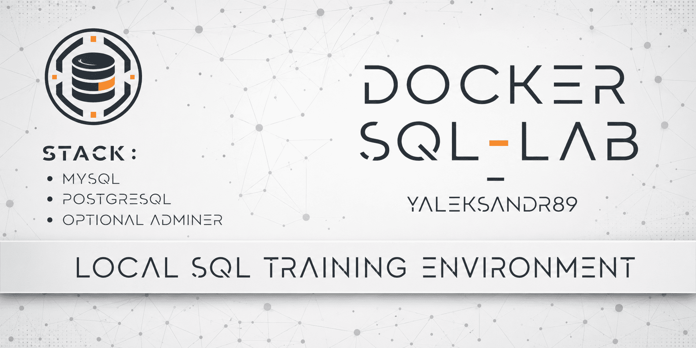
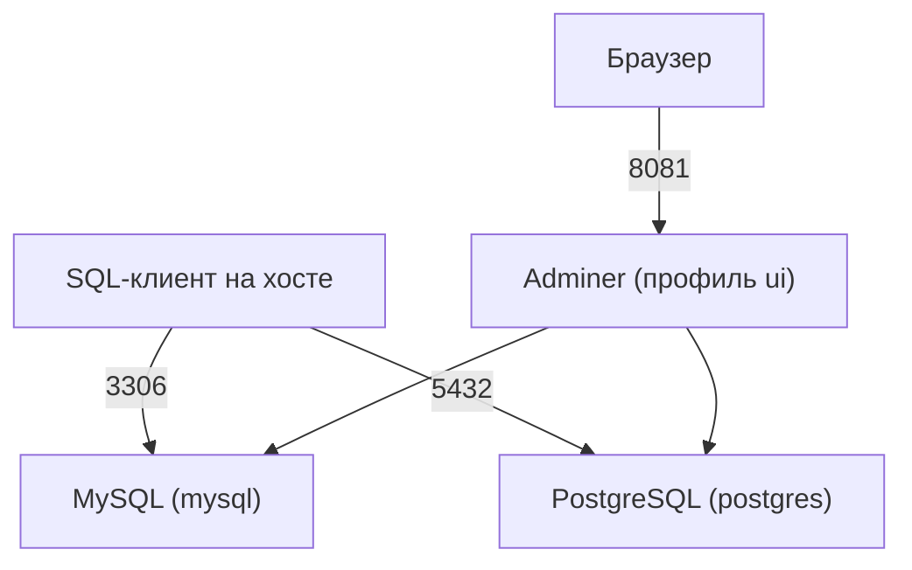

# Docker SQL Lab

[](https://github.com/yaleksandr89/docker-sql-lab)
[](https://www.mysql.com/)
[](https://www.postgresql.org/)
[](https://www.adminer.org/)
[](https://www.docker.com/)
[](https://github.com/yaleksandr89/docker-sql-lab/actions/workflows/sql-lab-check.yml)
[](https://github.com/yaleksandr89/docker-sql-lab/actions/workflows/mysql-check.yml)
[](https://github.com/yaleksandr89/docker-sql-lab/actions/workflows/postgres-check.yml)
[](LICENSE.md)



## Выберите язык

| Русский | English | Español | 中文 | Français | Deutsch |
|---|---|---|---|---|---|
| **Выбран** | [English](docs/langs/en/README.md) | [Español](docs/langs/es/README.md) | [中文](docs/langs/zh/README.md) | [Français](docs/langs/fr/README.md) | [Deutsch](docs/langs/de/README.md) |

Локальный Docker Compose-стенд для практики SQL и знакомства с MySQL и
PostgreSQL. Каждую СУБД можно запускать отдельно или обе вместе. Компактная
`demo` создаётся автоматически, а необязательные учебные базы Sakila, Pagila
и Chinook дают готовые данные для упражнений. Adminer подключается только при
необходимости.

## Скринкасты

В записях используется PhpStorm. Вместо него подойдут DataGrip, DBeaver,
Adminer или другой клиент MySQL/PostgreSQL.

| Сценарий | Яндекс.Диск | Google Drive | Что показано |
|---|---|---|---|
| Первый запуск с обязательной `demo`, затем добавление учебных баз | [Смотреть](https://disk.yandex.ru/i/Kj4TcMSBuIDVeA "docker-sql-lab-demo-then-training-databases.mp4") | [Смотреть](https://drive.google.com/file/d/1HzYWbMuBEobXlbGQYNfHYVAq95TLqEPf/view?usp=sharing "docker-sql-lab-demo-then-training-databases.mp4") | Запуск MySQL и PostgreSQL с обязательной `demo`; проверка; подготовка Sakila, Pagila и Chinook; подтверждённая переинициализация; повторная проверка и SQL-запросы. |
| Первый запуск с заранее подготовленными учебными базами | [Смотреть](https://disk.yandex.ru/i/nFgJZto8agbdWw "docker-sql-lab-training-databases-first-start.mp4") | [Смотреть](https://drive.google.com/file/d/1nKiGrJ4QINLCQcRk-k6vfTakpWsw-JS7/view?usp=sharing "docker-sql-lab-training-databases-first-start.mp4") | Подготовка Sakila, Pagila и Chinook до первого запуска; единая инициализация обязательной `demo` и учебных баз; проверка доступа и SQL-запросы. |

## Стек

- MySQL 9.7.1 LTS
- PostgreSQL 18.4
- Adminer 5.4.2 Docker Official Image
- Docker Compose v2
- GNU Make и Bash для команд проекта и сценариев инициализации

Закреплённые значения по умолчанию заданы в
[`.docker.env.example`](.docker.env.example); `make init` создаёт из него
локальный `.docker.env`. Сервисы описаны в
[`docker-compose.yml`](docker-compose.yml).

<details>
<summary>Важно: это учебное окружение</summary>

Проект не является готовым шаблоном для промышленной эксплуатации. Для
внешнего использования нужны отдельные решения по учётным данным, публикации
сервисов в сети, хранению данных, резервному копированию и эксплуатации.

</details>

## Возможности

- MySQL и PostgreSQL работают независимо или одновременно.
- Обязательная `demo` в каждой СУБД содержит одинаковые начальные записи.
- Необязательные Sakila и Chinook доступны для MySQL, Pagila и Chinook — для
  PostgreSQL.
- Adminer — отдельный дополнительный веб-интерфейс для обеих СУБД.
- Каталоги данных, инициализации и учебных баз разделены по СУБД и подключены
  в контейнеры с хоста.
- Проверки конфигурации и доступа, импорт доверенных SQL-файлов и команды
  очистки и переинициализации, удаляющие данные,
  собраны в [`Makefile`](Makefile).

## Архитектура и структура проекта



Порты по умолчанию: `3306`, `5432`, `8081`.

MySQL и PostgreSQL имеют отдельные каталоги данных, инициализации и учебных баз. Adminer работает внутри сети Compose; публикация портов на хосте по умолчанию ограничена loopback.

[Базы и учебные данные](docs/langs/ru/reference/databases.md).

## Требования

1. Git.
2. Docker Engine или Docker Desktop с Docker Compose v2.
3. GNU Make, Bash и базовые утилиты командной строки Unix, используемые
   сценариями.

Рекомендуемая среда: Linux; macOS с Docker Desktop; Windows с Docker Desktop
и WSL2. Выполняйте команды из корня репозитория. Ветка проекта по умолчанию —
`master`.

## Быстрый старт

```bash
git clone https://github.com/yaleksandr89/docker-sql-lab.git
cd docker-sql-lab
make init
make up
```

`make init` создаёт локальный `.docker.env` из отслеживаемого
[`.docker.env.example`](.docker.env.example), проверяет контролируемые пути
хранения и создаёт рабочие каталоги. При первом запуске официальные точки
входа инициализируют обе СУБД. Даже без необязательных учебных баз вы получите
рабочие MySQL и PostgreSQL с обязательной `demo` и начальными записями.

`make up` запускает MySQL, PostgreSQL и Adminer; `make up-no-ui` — обе СУБД
без Adminer. С настройками по умолчанию Adminer доступен по адресу
`http://127.0.0.1:8081`.

Подробно о запуске, подключениях и учётных данных:
[Начало работы](docs/langs/ru/guides/getting-started.md).

### Нужны готовые учебные данные?

Учебные базы не обязательны: `demo` создаётся всегда; для MySQL доступны
Sakila и Chinook, для PostgreSQL — Pagila и Chinook.

**Первый запуск, каталоги данных пусты**

```bash
make init
make samples-mysql
make samples-postgres
make up
```

Учебные базы подготавливаются до первой инициализации; официальные точки входа
загрузят их вместе с `demo`.

> **Внимание:** переинициализация удаляет данные выбранной СУБД. Резервная
> копия нужна, только если требуется сохранить собственные данные; для
> одноразового учебного стенда без ценных изменений она не обязательна.

<details>
<summary>Стенд уже запускался: добавить или повторно использовать учебные базы</summary>

**Уже инициализировано без учебных баз.** Обычный `make up` не применит новые
файлы инициализации или учебных баз. Сначала сохраните важные данные, затем
выполните нужный вариант:

- MySQL: `make samples-mysql`, затем `make reinit-mysql CONFIRM=1`.
- PostgreSQL: `make samples-postgres`, затем `make reinit-postgres CONFIRM=1`.
- Обе СУБД: `make samples-mysql`, `make samples-postgres`, затем `make reinit-all CONFIRM=1`.

> **Внимание:** `reinit-*` удаляет данные выбранной СУБД и выполняется только с точным `CONFIRM=1`.

**Учебные базы уже установлены.** Используйте обычный `make up` или выбранную
цель `make up-*`: повторная загрузка и переинициализация не нужны, базы
сохраняются в каталогах хоста, подключённых в контейнеры.

</details>

Подробнее: [Базы и учебные данные](docs/langs/ru/reference/databases.md).

## Режимы запуска

| Команда | MySQL | PostgreSQL | Adminer |
|---|---|---|---|
| `make up` | Запускает | Запускает | Запускает |
| `make up-no-ui` | Запускает | Запускает | Останавливает |
| `make up-mysql` | Запускает | Не запускает | Не запускает |
| `make up-postgres` | Не запускает | Запускает | Не запускает |

Команды одной СУБД не останавливают уже работающую другую; Adminer управляется
отдельно. Полный набор целей описан в [`Makefile`](Makefile).

## Подключения и доступные базы

Внутри Compose-сети Adminer использует серверы `mysql` и `postgres`. Клиенты на
хосте используют `127.0.0.1` и настроенные `MYSQL_PORT` или `POSTGRES_PORT`.
Для обычной работы укажите `DB_USER` и `DB_PASSWORD`.

| СУБД | Доступна всегда | После инициализации необязательных учебных баз |
|---|---|---|
| MySQL | `demo` | `sakila`, `chinook` |
| PostgreSQL | `demo` | `pagila`, `chinook` |

Имена необязательных баз действительны только после их фактической инициализации.
Подробности: [запуск и подключения](docs/langs/ru/guides/getting-started.md) ·
[базы и учебные данные](docs/langs/ru/reference/databases.md).

## Кратко об учётных данных

| Назначение | Пользователь | Пароль |
|---|---|---|
| Общий учебный пользователь | `DB_USER` | `DB_PASSWORD` |
| Администратор MySQL | `root` | `MYSQL_ROOT_PASSWORD` |
| Суперпользователь PostgreSQL | `POSTGRES_SUPERUSER` | `POSTGRES_SUPERUSER_PASSWORD` |

`POSTGRES_SUPERUSER` и `DB_USER` должны быть разными ролями. Для упражнений
используйте учебного пользователя и замените примерные пароли до публикации
сервисов.

## Базы и ключевые проверки

Обе `demo` содержат эквивалентную таблицу `demo_users` с пятью строками.
Статические проверки не требуют запущенных СУБД:

```bash
make check-env
make config
make test-storage-paths
```

После запуска `make check` проверяет `demo` и доступ `DB_USER`, а
`make test-sql-imports` — публичные цели импорта доверенных SQL-файлов. Порядок
и ограничения: [Проверки и эксплуатация](docs/langs/ru/guides/operations.md).

CI проверяет MySQL, PostgreSQL и совместную работу стенда при push и pull request в `master`; каждый workflow можно запустить вручную через Actions.

## Безопасность и жизненный цикл

- `BIND_ADDRESS=127.0.0.1` публикует сервисы только на интерфейсе обратной петли
  (loopback).
- `BIND_ADDRESS=0.0.0.0` открывает их на всех интерфейсах: заранее настройте
  межсетевой экран, надёжные учётные данные и доверенную сеть.
- Официальные точки входа выполняют инициализацию только для пустого каталога
  данных.
- `make mysql-import` и `make postgres-import` принимают только доверенный SQL.
  Это не изолированная среда (`sandbox`): возможна частичная запись без полного
  автоматического отката. Перед важным импортом проверьте SQL-файл и сделайте
  подходящую резервную копию.
- Встроенные `make dump` и `make restore` покрывают только MySQL `demo`;
  встроенной цели резервного копирования для PostgreSQL нет.
- Все цели `clean-*` и `reinit-*` удаляют данные и требуют точного
  `CONFIRM=1`.

Безопасные последовательности:
[Проверки и эксплуатация](docs/langs/ru/guides/operations.md).
При ошибках сначала соберите диагностику:
[Диагностика](docs/langs/ru/guides/troubleshooting.md).

## Лицензии учебных данных

Необязательные учебные наборы данных сохраняют лицензии и уведомления об
авторских правах и лицензиях исходных проектов. Происхождение, закреплённые
ревизии, сведения о целостности и тексты лицензий приведены в
[`THIRD_PARTY_NOTICES.md`](THIRD_PARTY_NOTICES.md).

## Документация

- [Начало работы](docs/langs/ru/guides/getting-started.md)
- [Базы и учебные данные](docs/langs/ru/reference/databases.md)
- [Проверки и эксплуатация](docs/langs/ru/guides/operations.md)
- [Диагностика](docs/langs/ru/guides/troubleshooting.md)
- [Участие в разработке](.github/CONTRIBUTING.md)

## Обратная связь

- Воспроизводимые ошибки — [GitHub Issues](https://github.com/yaleksandr89/docker-sql-lab/issues).
- Вопросы и идеи — [GitHub Discussions](https://github.com/yaleksandr89/docker-sql-lab/discussions).

---

<p align="center">
  Если пакет оказался полезен, поставьте звезду на GitHub — так его будет проще найти другим разработчикам. 🤘
</p>
