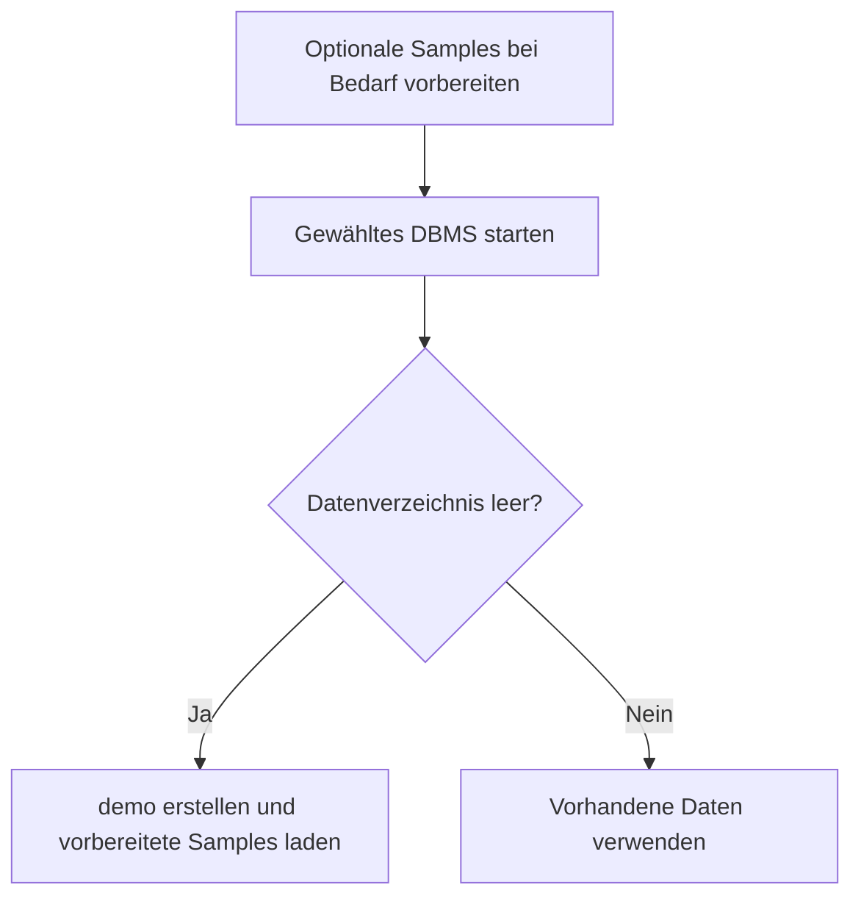

# Datenbanken und Samples

[Zurück zur README](../README.md)

## Sprache wählen

| Русский | English | Español | 中文 | Français | Deutsch |
|---|---|---|---|---|---|
| [Русский](../../ru/reference/databases.md) | [English](../../en/reference/databases.md) | [Español](../../es/reference/databases.md) | [中文](../../zh/reference/databases.md) | [Français](../../fr/reference/databases.md) | **Ausgewählt** |

## Abschnitt

| Erste Schritte | Datenbanken und Samples | Prüfungen und Betrieb | Diagnose und Fehlerbehebung |
|---|---|---|---|
| [Erste Schritte](../guides/getting-started.md) | **Ausgewählt** | [Prüfungen und Betrieb](../guides/operations.md) | [Diagnose und Fehlerbehebung](../guides/troubleshooting.md) |

<a id="section-demo"></a>
## Obligatorische `demo`-Datenbanken

Beide DBMS initialisieren `demo`:

- MySQL: `demo.demo_users`
- PostgreSQL: `demo.public.demo_users`

Die Tabellen besitzen entsprechende Felder `id`, `name`, `email` und
`created_at` sowie Alice, Bob, Carol, Dave und Eve. Zusätzliche Zeilen sind
zulässig. `make check-env` verlangt `MYSQL_DATABASE=demo` und
`POSTGRES_DATABASE=demo`.

<a id="section-optional-samples"></a>
## Optionale Samples

| DBMS | Optionale Datenbanken | Vorbereitung |
|---|---|---|
| MySQL | `chinook`, `sakila` | `make samples-mysql` |
| PostgreSQL | `pagila`, `chinook` | `make samples-postgres` |

<a id="section-sample-preparation"></a>
## Samples vorbereiten

Die Vorbereitung benötigt `curl` und `git`; MySQL-Samples erfordern zusätzlich `unzip` und `sha256sum`.

Die Vorbereitung lädt festgelegte upstream-Dateien herunter und prüft sie,
startet aber keine Container und importiert nichts in bereits initialisierte
Datenbanken. Temporäre Downloads bleiben lokal, werden nicht committed und
liegen unter `MYSQL_SAMPLES_DIR` beziehungsweise `POSTGRES_SAMPLES_DIR`.
Herkunft, Integritätswerte und Lizenzen stehen in
[`THIRD_PARTY_NOTICES.md`](../../../../THIRD_PARTY_NOTICES.md).

Wann die Vorbereitung erfolgen muss und wie ein vorhandenes DBMS neu
initialisiert wird, steht unter
[Initialisierung und Lebenszyklus](#section-initialization).

Ein vollständig fehlendes Sample wird übersprungen und verhindert `demo`
nicht. Unvollständige Samples oder unerwartete Datenbanken werden ohne
automatische Reparatur oder Löschung abgelehnt.

<a id="section-storage-layout"></a>
## Speicherstruktur

```text
data/
├── mysql/
└── postgres/

initdb/
├── mysql/
└── postgres/
```

| DBMS | Data | Init | Optionale Samples |
|---|---|---|---|
| MySQL | `MYSQL_DATA_DIR` (`./data/mysql`) | `MYSQL_INITDB_DIR` (`./initdb/mysql`) | `MYSQL_SAMPLES_DIR` (`./samples/mysql`) |
| PostgreSQL | `POSTGRES_DATA_DIR` (`./data/postgres`) | `POSTGRES_INITDB_DIR` (`./initdb/postgres`) | `POSTGRES_SAMPLES_DIR` (`./samples/postgres`) |

Data- und Sample-Pfade sind über `.docker.env` konfigurierbar und werden als
managed paths validiert. Die Regeln für init-Verzeichnisse stehen unter
[Initialisierung und Lebenszyklus](#section-initialization). Bearbeiten Sie
Dateien in `data/` nicht manuell; sie können numerischen Container-UID/GID
gehören.

<a id="section-initialization"></a>
## Initialisierung und Lebenszyklus



> **Wichtig:** Offizielle MySQL- und PostgreSQL-Entrypoints führen init-Dateien
> nur bei leerem data directory aus. Nach der Initialisierung hinzugefügte
> Dateien ändern keine bestehende Datenbank. `make down` erhält die Daten; eine
> bestätigte Neuinitialisierung löscht dagegen die aktuellen Daten des gewählten
> DBMS und erstellt die Datenbanken aus den aktuellen Init-Skripten neu. Ein
> Backup ist nur nötig, wenn eigene Daten erhalten bleiben sollen; ein einmaliges
> Lab ohne wertvolle Änderungen braucht keines.

Bereiten Sie Samples für die erste Initialisierung vor dem ersten Start vor:

```bash
make samples-mysql
make up-mysql

make samples-postgres
make up-postgres
```

Sichern Sie bei einem initialisierten DBMS eigene Daten bei Bedarf und verwenden
Sie dann nur die passende bestätigte Neuinitialisierung:

```bash
make samples-mysql
make reinit-mysql CONFIRM=1

make samples-postgres
make reinit-postgres CONFIRM=1
```

<a id="section-training-access"></a>
## Lernzugriff und Ownership

MySQL erstellt `DB_USER` und gewährt Zugriff auf alle beim init
gefundenen Nicht-Systemdatenbanken. PostgreSQL erstellt einen getrennten
`DB_USER` ohne superuser/createdb/createrole und macht ihn zum Eigentümer von
`demo`, dem `public`-Schema und geladenen Sample-Objekten. Administrative
credentials bleiben getrennt: `MYSQL_ROOT_PASSWORD`, `POSTGRES_SUPERUSER`
und `POSTGRES_SUPERUSER_PASSWORD`. Bearbeiten Sie container-owned Dateien in
`data/` nicht manuell.

[Zurück zur README](../README.md)
